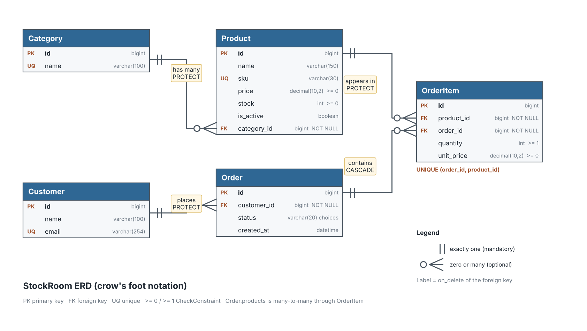

# StockRoom: Catalogue and Order Data System

A Django project that models a small product catalogue with customers and orders. It was built for Unit 5 to practise relational design, models, constraints, migrations, CRUD, QuerySets, relationship traversal, and aggregation with the Django ORM.

Author: Ghadah Alabbadi

## 1. Setup

Requirements: Python 3.14 and Django 6.1 (installed from `requirements.txt`).

```powershell
git clone https://github.com/GhadahAlabbadi/ghadahAlabbadi-stockroomProject.git
cd ghadahAlabbadi-stockroomProject
python -m venv venv
venv\Scripts\Activate.ps1
pip install -r requirements.txt
python manage.py migrate
python manage.py seed_data
python manage.py createsuperuser   # optional, for the admin site
python manage.py runserver         # admin at http://127.0.0.1:8000/admin/
```

Useful commands:

| Command                                        | Purpose                                                                          |
| ---------------------------------------------- | -------------------------------------------------------------------------------- |
| `python manage.py seed_data`                   | Loads the sample data. If products already exist it changes nothing and says so. |
| `python manage.py seed_data --reset`           | Deletes all StockRoom rows and loads the sample data again.                      |
| `python manage.py show_evidence crud`          | Runs the CRUD demo (rolled back, data unchanged).                                |
| `python manage.py show_evidence querysets`     | Runs the QuerySet and lookup queries.                                            |
| `python manage.py show_evidence relationships` | Runs the relationship queries and explanations.                                  |
| `python manage.py show_evidence aggregation`   | Runs the aggregation and annotation queries.                                     |
| `python manage.py show_constraints`            | Shows that invalid data is rejected (rolled back).                               |

## 2. Project structure

```
ghadahAlabbadi-stockroomProject/
  manage.py
  requirements.txt
  stockroom_project/            Django project settings and URLs
  inventory/                    The single app
    models.py                   The five models
    admin.py                    Admin registration (OrderItem inline on Order)
    queries.py                  ORM evidence code (CRUD, QuerySets, relationships, aggregation)
    migrations/                 0001_initial.py and 0002_add_product_is_active.py
    management/commands/
      seed_data.py              Sample data loader
      show_evidence.py          Prints query evidence by section
      show_constraints.py       Constraint rejection demo
  docs/
    ERD_annotated.png           ERD with optionality and on_delete labels
    ERD.png                     Earlier ERD exported from dbdiagram.io
    stockroom.dbml              DBML source of the diagram (dbdiagram.io)
    evidence.txt                Full output of all evidence commands
```

## 3. Entity relationship diagram



The diagram uses crow's foot notation: a double bar means exactly one (mandatory) and a circle with a crow's foot means zero or many (optional). The label on each line is the `on_delete` rule of that foreign key. The same information is in the table below. `docs/ERD.png` is the earlier dbdiagram.io version and `docs/stockroom.dbml` is its source.

| Relationship         | Cardinality                    | Optionality                                                                           | on_delete      |
| -------------------- | ------------------------------ | ------------------------------------------------------------------------------------- | -------------- |
| Category to Product  | One to many                    | A product must have exactly one category. A category may have no products.            | PROTECT        |
| Customer to Order    | One to many                    | An order must have exactly one customer. A customer may have no orders.               | PROTECT        |
| Order to OrderItem   | One to many                    | An item must belong to exactly one order. An order may have no items in the database. | CASCADE        |
| Product to OrderItem | One to many                    | An item must refer to exactly one product. A product may appear in no orders.         | PROTECT        |
| Order to Product     | Many to many through OrderItem | Both sides optional                                                                   | not applicable |

Why each `on_delete` was chosen:

- **Category to Product, PROTECT.** Deleting a category must not silently delete or orphan its products. The deletion is refused until the products are moved or removed.
- **Customer to Order, PROTECT.** Orders are business history. Deleting a customer must not erase their orders.
- **Order to OrderItem, CASCADE.** An order item has no meaning without its order, so removing an order removes its lines.
- **Product to OrderItem, PROTECT.** Past sales must keep pointing at the product that was sold. Retired products are hidden with `is_active=False` instead of being deleted.

## 4. Models

| Model     | Fields                                                                                                                 | Meta                            |
| --------- | ---------------------------------------------------------------------------------------------------------------------- | ------------------------------- |
| Category  | `name` (unique)                                                                                                        | ordering by name                |
| Product   | `name`, `sku` (unique), `price`, `stock`, `is_active`, `category` (FK)                                                 | ordering by name                |
| Customer  | `name`, `email` (unique)                                                                                               | ordering by name                |
| Order     | `customer` (FK), `status` (pending, paid, shipped, cancelled), `created_at` (auto), `products` (M2M through OrderItem) | ordering by newest first        |
| OrderItem | `order` (FK), `product` (FK), `quantity`, `unit_price`                                                                 | ordering by order, then product |

Every model defines `__str__`. `OrderItem` is a real model, not an automatic many-to-many table, because each order line needs its own `quantity` and `unit_price` and a rule that one product appears once per order. `unit_price` is stored on the line so that a later change to `Product.price` does not rewrite past orders.

### Constraints

| Constraint                          | Rule                                             |
| ----------------------------------- | ------------------------------------------------ |
| `product_price_non_negative`        | `price >= 0`                                     |
| `product_stock_non_negative`        | `stock >= 0`                                     |
| `orderitem_quantity_at_least_one`   | `quantity >= 1`                                  |
| `orderitem_unit_price_non_negative` | `unit_price >= 0`                                |
| `unique_product_per_order`          | one row per (order, product)                     |
| unique fields                       | `Category.name`, `Product.sku`, `Customer.email` |

`python manage.py show_constraints` proves each rule. A valid boundary row (price 0.00, stock 0) is accepted, and all eight invalid inserts are rejected by the database with an `IntegrityError`. The output is saved in `docs/evidence.txt`.

## 5. Migrations

| Migration                    | Content                                                |
| ---------------------------- | ------------------------------------------------------ |
| `0001_initial`               | Creates the five models and all constraints.           |
| `0002_add_product_is_active` | Adds `Product.is_active` (BooleanField, default True). |

The second migration is the genuine schema change. The business needs to retire a product without deleting it, because order history refers to it. Because the field has a default, the existing rows were upgraded to active without errors. Commands used: `makemigrations --name`, `sqlmigrate`, `showmigrations`, `migrate`. The migration files are committed in the repository.

## 6. Sample data

Loaded by `python manage.py seed_data`. It contains 3 categories, 10 products, 3 customers, 6 orders and 12 order items.

| SKU  | Product           | Category    | Price | Stock | Active |
| ---- | ----------------- | ----------- | ----- | ----- | ------ |
| E001 | Wireless Mouse    | Electronics | 24.99 | 40    | yes    |
| E002 | USB-C Cable       | Electronics | 8.50  | 120   | yes    |
| E003 | Bluetooth Speaker | Electronics | 59.90 | 4     | yes    |
| E004 | Webcam HD         | Electronics | 45.00 | 30    | yes    |
| S001 | Notebook A5       | Stationery  | 3.75  | 200   | yes    |
| S002 | Gel Pen Pack      | Stationery  | 5.20  | 5     | yes    |
| S003 | Marker Set        | Stationery  | 12.40 | 2     | no     |
| G001 | Coffee Beans 1kg  | Groceries   | 19.99 | 60    | yes    |
| G002 | Green Tea Box     | Groceries   | 6.50  | 3     | yes    |
| G003 | Honey Jar         | Groceries   | 14.75 | 25    | no     |

The data was chosen on purpose: inactive products, low-stock products (one at exactly 5), different price levels, inactive products that still appear in orders, all four order statuses, and one order line sold at a discounted `unit_price` (22.00 for the Wireless Mouse in order 5). There are six orders so that "five most recent" is a meaningful filter.

## 7. Query evidence

Each item gives the business question, the ORM statement, and the result. The complete output with every statement is in `docs/evidence.txt`.

### CRUD

Create, retrieve, update and delete were demonstrated for all models inside a transaction that is rolled back, so the sample data stays unchanged (10 products afterwards). Deleting a category that has products raised `ProtectedError`. Deleting an order removed its order item but not its product.

### QuerySets and lookups

| Business question                                | ORM statement                                                               | Result                                                     |
| ------------------------------------------------ | --------------------------------------------------------------------------- | ---------------------------------------------------------- |
| Which products are active?                       | `Product.objects.filter(is_active=True)`                                    | 8 products                                                 |
| Which products have stock of 5 or less?          | `Product.objects.filter(stock__lte=5)`                                      | Bluetooth Speaker, Gel Pen Pack, Green Tea Box, Marker Set |
| Which products cost between 10.00 and 30.00?     | `Product.objects.filter(price__range=(Decimal("10.00"), Decimal("30.00")))` | Coffee Beans, Honey Jar, Marker Set, Wireless Mouse        |
| Which names contain "cable", ignoring case?      | `Product.objects.filter(name__icontains="CABLE")`                           | USB-C Cable                                                |
| Which products remain without the inactive ones? | `Product.objects.exclude(is_active=False)`                                  | 8 products                                                 |
| Products ordered by category name, then name     | `Product.objects.order_by("category__name", "name")`                        | Electronics, then Groceries, then Stationery               |
| Five newest orders                               | `Order.objects.order_by("-created_at", "-pk")[:5]`                          | Orders 6, 5, 4, 3, 2                                       |
| Search name or SKU                               | `Product.objects.filter(Q(name__icontains=t) \| Q(sku__icontains=t))`       | "mouse" gives 1 product, "g00" gives 3                     |
| Sold at a different price than today             | `OrderItem.objects.exclude(unit_price=F("product__price"))`                 | 1 item (Wireless Mouse in order 5)                         |
| Sell 5 units of E001                             | `Product.objects.filter(sku="E001").update(stock=F("stock") - 5)`           | stock 40 to 35 (rolled back to 40)                         |

### Relationships

| Direction    | Statement                                                      | Result                                  |
| ------------ | -------------------------------------------------------------- | --------------------------------------- |
| Forward      | `Product.objects.get(sku="E001").category`                     | Electronics                             |
| Forward      | `Order.objects.get(pk=5).customer`                             | Lina Haddad                             |
| Reverse      | `Category.objects.get(name="Electronics").products.all()`      | 4 products                              |
| Reverse      | `Customer.objects.get(email="aisha@example.com").orders.all()` | Orders 6, 2, 1                          |
| Reverse      | `Order.objects.get(pk=5).items.all()`                          | 3 items                                 |
| Many to many | `Order.objects.get(pk=5).products.all()`                       | Coffee Beans, Webcam HD, Wireless Mouse |
| Many to many | `Product.objects.get(sku="E001").orders.all()`                 | Orders 5 and 1                          |

The same two many-to-many questions were also written as lookups across relationships (`Product.objects.filter(order_items__order__pk=5)` and `Order.objects.filter(items__product__sku="E001")`) and gave the same results.

Written explanations, printed in `docs/evidence.txt`:

1. **Forward and reverse traversal.** Forward follows the ForeignKey to one object. Reverse uses the `related_name` and returns a QuerySet. Both use the same foreign key column.
2. **Why OrderItem is a model.** An order line needs `quantity`, `unit_price` and a uniqueness rule, which an automatic join table cannot hold.
3. **`get()` and `filter()`.** `get()` returns exactly one object and raises `DoesNotExist` or `MultipleObjectsReturned`. `filter()` always returns a QuerySet.
4. **Lazy evaluation.** A QuerySet runs SQL only when it is evaluated (iterated, `list()`, `len()`, `count()`, and so on), then caches its rows. The demo counted 0, 1, 1, then 2 queries.

### Aggregation and annotation

| Business question                  | ORM statement                                                                                                                                                           | Result                                      |
| ---------------------------------- | ----------------------------------------------------------------------------------------------------------------------------------------------------------------------- | ------------------------------------------- |
| How many products exist?           | `Product.objects.aggregate(total_products=Count("pk"))`                                                                                                                 | 10                                          |
| Average price of active products   | `Product.objects.filter(is_active=True).aggregate(average_price=Avg("price"))`                                                                                          | 21.72875                                    |
| Total stock of active products     | `Product.objects.filter(is_active=True).aggregate(total_stock=Sum("stock"))`                                                                                            | 462                                         |
| Products per category              | `Category.objects.annotate(product_count=Count("products"))`                                                                                                            | Electronics 4, Groceries 3, Stationery 3    |
| Items per order                    | `Order.objects.annotate(item_count=Count("items"))`                                                                                                                     | Orders 1 to 6: 2, 2, 2, 1, 3, 2             |
| Total value per order              | `Order.objects.annotate(total_value=Sum(ExpressionWrapper(F("items__quantity") * F("items__unit_price"), output_field=DecimalField(max_digits=12, decimal_places=2))))` | 75.48, 58.30, 99.88, 32.50, 86.99, 66.70    |
| Cross-check of all order items     | `OrderItem.objects.aggregate(Sum(quantity * unit_price))`                                                                                                               | 419.85 (equals the sum of the order totals) |
| Active products per category       | `Count("products", filter=Q(products__is_active=True))`                                                                                                                 | Electronics 4, Groceries 2, Stationery 2    |
| Category with most active products | the same annotation, `order_by("-active_count", "name").first()`                                                                                                        | Electronics (4)                             |

All values match the sample data tables above. SQLite may print decimals with trailing zeros, for example `21.7287500000000`, which is the same value.

Why `aggregate()` and `annotate()` differ:

- `aggregate()` collapses the whole QuerySet into one summary row, so it returns one dictionary and ends the chain.
- `annotate()` keeps the QuerySet and adds a calculated value to each object, so it can be filtered and ordered afterwards.
- For the category calculations the group is the Category. For the order calculations the group is the Order. In both cases the related rows are joined and then counted or summed per group.
- The item count and the order value were run as two separate queries, because combining annotations over the same join can multiply rows and inflate the numbers.

## 8. Known limitations

- Creating an order item does not reduce `Product.stock`. Stock is changed only by explicit updates.
- An order can exist with no items, because the database does not enforce "at least one item".
- Order totals are calculated when queried and are not stored.
- Order statuses can change in any direction, there is no workflow check.
- Orders in the sample data are created within seconds of each other, so ordering newest first also uses the primary key as a tie breaker.
- The project uses SQLite and has no user interface other than the Django admin. There are no automated tests.

## 9. Future improvements

- Reduce stock automatically when an order item is created, inside a transaction using an `F()` expression.
- Add a status workflow that only allows valid transitions, for example pending to paid to shipped.
- Add views or a REST API and a simple front end for browsing products and placing orders.
- Add indexes on frequently filtered fields and move to PostgreSQL for production.
- Add automated tests for the models, constraints and queries.

## Output screenshots

All outputs are also saved as screenshots in the `outputs/` folder.

| Requirement                             | Screenshot                                                         |
| --------------------------------------- | ------------------------------------------------------------------ |
| Project check and migration consistency | `outputs/01_django_check.png`                                      |
| Migrations applied                      | `outputs/02_showmigrations.png`                                    |
| Initial migration SQL                   | `outputs/03_sqlmigrate_0001.png`                                   |
| Schema change migration SQL             | `outputs/04_sqlmigrate_0002.png`                                   |
| Sample data loaded                      | `outputs/05_seed_data.png`                                         |
| Admin: products and orders              | `outputs/06_admin_products.png`, `outputs/07_admin_orders.png`     |
| CRUD                                    | `outputs/08_crud_a.png`, `outputs/08_crud_b.png`                   |
| QuerySets and lookups                   | `outputs/09_querysets_a.png`, `outputs/09_querysets_b.png`         |
| Relationship queries and explanations   | `outputs/10_relationships_a.png`, `outputs/10_relationships_b.png` |
| Aggregation and annotation              | `outputs/11_aggregation_a.png`, `outputs/11_aggregation_b.png`     |
| Constraint checks                       | `outputs/12_constraints.png`                                       |
| Server starts                           | `outputs/13_runserver.png`                                         |
